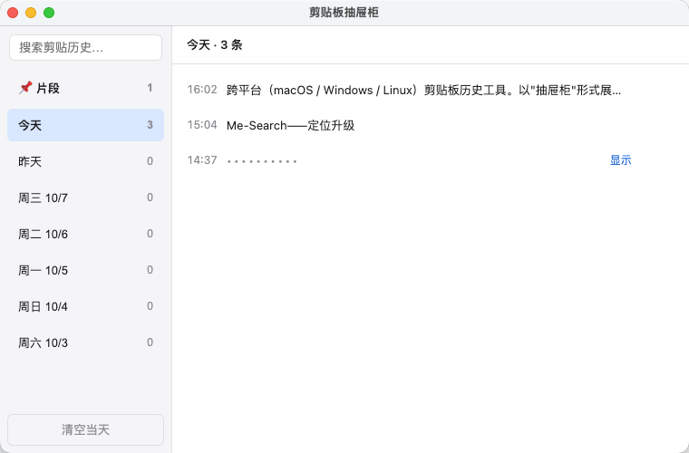
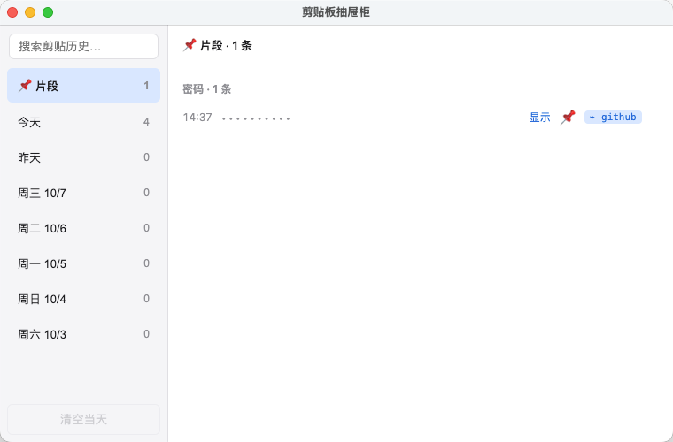
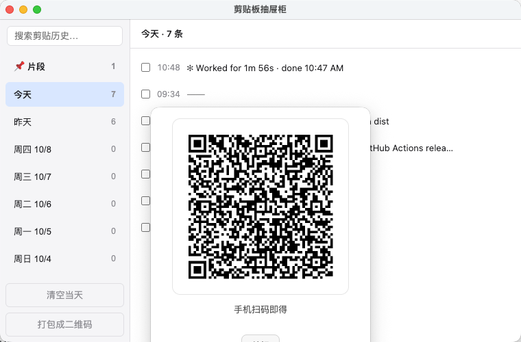

# 剪贴板抽屉柜 (Clipboard Drawer)

[](LICENSE)

跨平台（macOS / Windows / Linux）剪贴板历史工具。以"抽屉柜"形式展示剪贴板历史：左侧为最近 7 个日期的抽屉，点击抽屉右侧展示当天复制的所有内容（文本与图片）。支持局域网多机实时共享剪贴板。

## 界面一览

主窗口（日期抽屉 + 隐私打码渲染——疑似密码以 `••••••••` 显示，可临时显示）：



片段库视图（Pin 的片段按分组收纳，触发词徽章随叫随贴）：



扫码快传（条目/当天/多选生成二维码，手机扫码即得——短内容离线可扫，长内容自动局域网传输）：



## 功能

- 常驻系统托盘，按 `Cmd/Ctrl+Shift+V` 全局唤起
- 桌宠悬浮窗：右下角迷你抽屉精灵，复制即冒预览气泡（密码只显 🔒），待机随机小动作，单击开主窗口，可拖动换位
- 扫码快传：条目/当天/多选一键生成二维码，手机扫码即得（短内容离线可扫，长内容自动局域网传输）
- 局域网共享剪贴板：一台机器开「共享主机」，其他机器输 IP + 配对码连接，复制内容实时同步到所有机器（断网自动补拉补齐）
- 最近 7 天日期抽屉，显示每天条数
- 点击文本重新复制到剪贴板
- 图片剪贴板自动存档（截图/复制图片，>10MB 跳过），行内缩略图，点击复制图片
- 片段库：历史文本一键 Pin，设触发词与分组，`Cmd/Ctrl+Shift+;` 快速粘贴面板随叫随贴
- 隐私安全区：自动识别疑似密码，托盘菜单可切换"记录但打码（默认）/完全不记录"
- 跨全部历史搜索（不限 7 天）：模糊匹配（错拼也能命中）、拼音搜索（输 `shouhuodizhi` 找到「收货地址」），按匹配度排序、命中高亮
- 删除单条 / 清空当天；同一天相同文本自动去重
- 数据存于本地 SQLite（`userData/clipboard.db`），永久保留
- 深色/浅色跟随系统；失去焦点自动隐藏

## 片段库与快速粘贴

把常用短语变成"随叫随贴"的片段：

1. 在任意**文本**条目上悬浮，点 📌 打开 Pin 表单；
2. 可选填**触发词**（1-32 位字母/数字/连字符/下划线，大小写不敏感地唯一）和**分组**（如"工作"）；
3. 主窗口左侧的 **📌 片段** 抽屉按分组展示全部片段；再次点 📌 可修改或取消 Pin。

按 `Cmd/Ctrl+Shift+;` 随时唤起快速粘贴面板：输入触发词前缀或内容片段即时过滤（触发词命中排前面），`↑↓` 选择、`Enter` 直接粘贴回之前的应用（macOS 需授予"辅助功能"权限；粘贴失败时内容仍在剪贴板，面板会给出提示）。

## 隐私安全区

自动识别疑似密码的内容（长度、字符种类、信息熵多重启发式）。托盘菜单"隐私模式"可随时切换，两种模式都只影响切换后的新剪贴板：

- **记录但打码**（默认）：照常入库，界面以 `••••••••` 显示，点"显示"可临时查看，复制不受影响；
- **完全不记录**：疑似密码直接跳过，不留任何痕迹。

## 快捷键

- `Cmd/Ctrl+Shift+V` 全局唤起窗口
- `↑` / `↓` 选择条目，`Enter` 复制选中条目
- `Cmd/Ctrl+K` 聚焦搜索框
- `Cmd/Ctrl+Shift+;` 片段快速粘贴面板（↑↓ 选择，Enter 粘贴，Esc 取消）
- `Esc` 清空搜索（有搜索词时）或隐藏窗口

## 开发

```bash
npm install        # 安装依赖（postinstall 自动重编译 better-sqlite3）
npm test           # 运行单元测试（node:test）
npm start          # 启动应用
```

## 打包

```bash
npm run pack       # 免安装目录（dist/）
npm run dist       # 完整安装包（mac: dmg / win: nsis / linux: AppImage）
```

跨平台构建（如在本机打出 Linux 包）：`npx electron-builder --linux`（或 `--win` / `--mac`）。注意原生模块与 Electron 版本按本机架构/平台编译——在 Apple Silicon Mac 上打出的 Linux 包是 arm64，目标机器为 x86_64 时需用 x64 机器或 CI（见 `.github/workflows/release.yml`）构建。

## 数据位置

- macOS: `~/Library/Application Support/clipboard-drawer/`
- Windows: `%APPDATA%/clipboard-drawer/`
- Linux: `~/.config/clipboard-drawer/`

其中：`clipboard.db` 为剪贴板历史（SQLite），`images/` 为图片存档，`config.json` 为隐私模式等配置。

自定义存储位置：托盘菜单「更改存储位置…」可把数据目录换到任意位置（如另一块磁盘）；切换后新位置从零开始记录（该目录已有 clipboard.db 则沿用），旧数据原地保留不动；「恢复默认位置」切回。config.json 永远留在默认 userData 目录，只有 clipboard.db 和 images/ 移到所选位置。

## 局域网共享

托盘菜单「开启共享主机…」把本机变为共享源（托盘显示 IP:端口，「复制配对码」给配对用）；其他机器「连接共享主机…」输入 IP:端口 + 配对码即可。同步内容：文本与图片（疑似密码各端按自己的隐私模式打码）。只同步开启后的新内容；断网期间的内容恢复连接后自动补齐。仅建议可信局域网使用（明文传输 + 配对码鉴权）。

## 协议

[MIT License](LICENSE)
